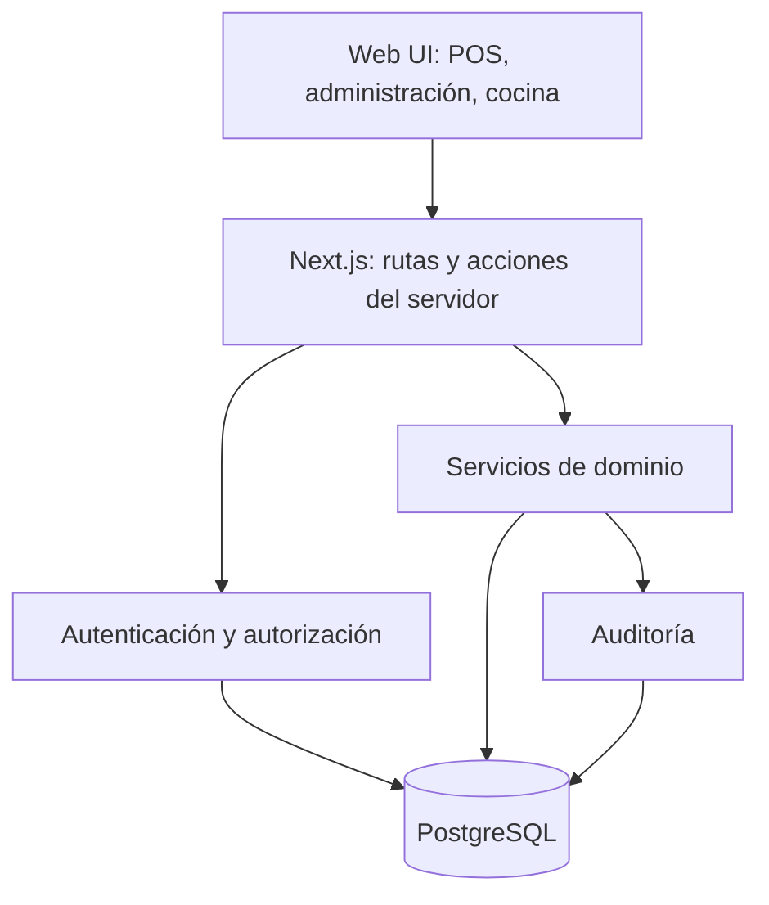

# Arquitectura técnica

Estado: propuesta inicial, sujeta a decisiones documentadas y validación durante la implementación.

## Decisión principal
Monolito modular con Next.js App Router y PostgreSQL. Una aplicación desplegable simplifica la operación inicial; los módulos deben tener límites claros sin microservicios prematuros.



## Estructura prevista
```text
src/
  app/
  components/
    ui/
  modules/
    auth/
    organizations/
    catalog/
    orders/
    kitchen/
    cash/
    inventory/
    reports/
  lib/
  generated/
prisma/
docs/
tests/
  unit/
  integration/
  e2e/
.github/workflows/
```

## Límites y persistencia
Cada módulo contiene reglas de negocio, validación y servicios de aplicación. Las rutas y acciones del servidor orquestan servicios; los componentes visuales no consultan la base directamente desde el navegador. Prisma y PostgreSQL implementan persistencia, migraciones, restricciones e índices.

Entidades previstas: Organization, Branch, User, Membership, Role, Permission, Category, Product, ProductVariant, RestaurantTable, Customer, Order, OrderItem, Payment, CashShift, Ingredient, Recipe, StockMovement, AuditEvent. El esquema definitivo se versionará mediante migraciones.

## Seguridad multiempresa
- Resolver el contexto de organización y sucursal desde la sesión autenticada y las membresías autorizadas.
- Filtrar todas las operaciones por ese contexto; verificar pertenencia de las relaciones.
- Usar restricciones y claves compuestas donde permitan proteger la integridad entre organizaciones.
- Validar entradas con Zod y limitar los campos de salida.
- Usar sesiones seguras, expiración y revocación; no guardar credenciales ni tokens en el repositorio.
- Proteger mutaciones frente a solicitudes no autorizadas, CSRF cuando corresponda y abuso.
- Probar explícitamente accesos cruzados, cambios de rol y operaciones concurrentes.

## Integridad operativa
Transacciones para cambios correlacionados, restricciones únicas para números de pedido, claves de idempotencia en cobros y control de concurrencia. Conservar instantáneas de precios en pedidos. No eliminar registros financieros históricos de forma destructiva.

## Entornos y calidad
Desarrollo local, pruebas y producción separados; bases y credenciales independientes. Biome, comprobación TypeScript, Vitest, Playwright y GitHub Actions. Las versiones exactas de dependencias y Node.js se fijarán al inicializar el proyecto. Los cambios a main deberán superar comprobaciones reproducibles.

## Decisiones pendientes
Proveedor de autenticación, alojamiento, estrategia de tiempo real para KDS, modelo fiscal, retención de auditoría y política de respaldo. No se presuponen servicios contratados ni certificaciones.
