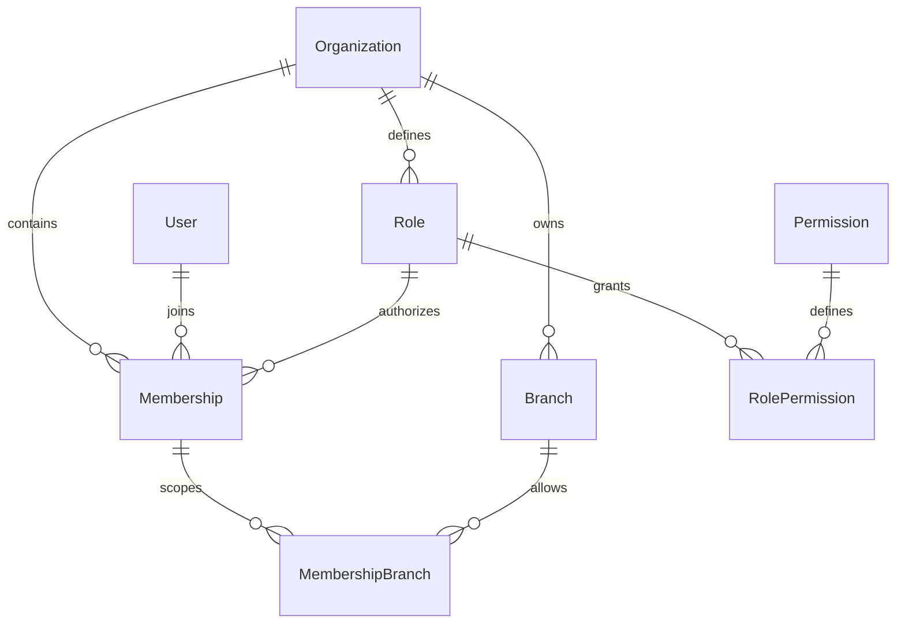

# Base de datos: identidad multiempresa

PostgreSQL y Prisma. La primera migración introduce organizaciones, sucursales, usuarios, membresías, roles y permisos.



Una identidad de usuario puede pertenecer a varias organizaciones. Cada membresía tiene un rol de su organización. Las asignaciones a sucursal utilizan claves foráneas compuestas para impedir asociaciones con otra organización. Esto no sustituye la autorización de consultas y acciones del servidor, que se implementará en la fase de autenticación.

## Desarrollo local
Crear una base PostgreSQL nueva y separada del ERP anterior. Copiar .env.example a .env y configurar DATABASE_URL con las credenciales locales. No incluir .env en Git.

```bash
npm install
npm run db:validate
npm run db:generate
npm run db:deploy
npm run dev
```

Para cambios futuros al esquema, usar npm run db:migrate en desarrollo y revisar la migración antes de publicarla. No ejecutar reset en bases con datos.

## Pruebas
CI inicia un PostgreSQL desechable, aplica las migraciones y verifica que un rol o una sucursal de otra organización sean rechazados por la base. La autenticación, normalización del email, permisos efectivos y filtros de lectura siguen pendientes. No se han creado usuarios reales ni credenciales iniciales.
